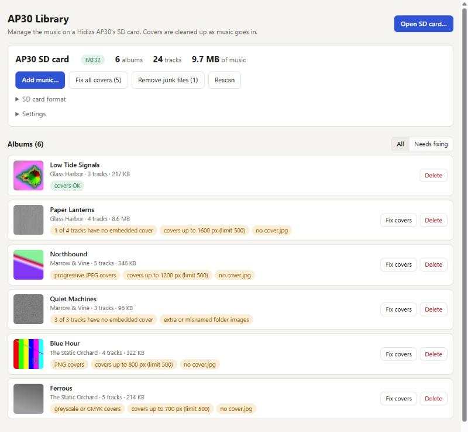

# AP30 Library

**Open it: https://guillochon.github.io/ap30-library/** (Chrome or Edge on a desktop computer)

Tools for keeping the music library on a **Hidizs AP30** (and similar Rockchip RKnano players) in a shape its firmware handles well.

The stock firmware is slow to start tracks and often fails to show album art when covers are large, progressive JPEGs, PNGs or greyscale images, or differ from track to track. These tools rewrite only the artwork, never the audio, so every album has one small cover the player can decode.

## ap30-library.html

A single-file web page for managing the SD card. Use it from [GitHub Pages](https://guillochon.github.io/ap30-library/), or download the file and open it in **Chrome or Edge** on a desktop computer. It uses the File System Access API, so it needs no install and uploads nothing.

- **Open SD card…**: choose the card's drive (or a folder on it, if Chrome won't open the drive itself).
- **Format check**: tells FAT32 from exFAT by how the card stores file times (FAT32 rounds to 2 s, exFAT to 10 ms). The page can't format the card; the *SD card format* panel lists the commands for Windows, macOS and Linux.
- **Problem detection**: flags each album with covers that are too large, progressive, PNG, greyscale/CMYK, missing, duplicated or inconsistent between tracks; missing or extra folder images; unreadable files; formats the AP30 can't play; and macOS junk files (`._*`, `.DS_Store`).
- **Add music…**: choose a folder on your computer. It is copied to the card with clean covers: each track is read once and written straight to the card with a single embedded front cover, and `cover.jpg` sits beside it. **Source files are opened read-only and never modified.** Logs and cue sheets are skipped unless you ask for them. Tick *Ignore explicit tracks when copying* (under *Settings*, off by default) to leave out tracks tagged explicit: `ITUNESADVISORY` 1 or 4, `EXPLICIT`/`ADVISORY`/`CONTENTRATING`, the iTunes rating in M4A files, or a title ending in "(Explicit)" or "[Explicit]". It reads FLAC, MP3, M4A, Ogg and Opus tags.
- **Fix covers**: repairs albums already on the card in place. A second run writes nothing.
- Delete albums and remove junk files, each after a confirmation.

A clean cover is a baseline (non-progressive) RGB JPEG, 500 px on the long side by default. Size and quality are adjustable under *Settings*. Embedded covers are rewritten for FLAC and MP3 (ID3v2.3/2.4); other formats get `cover.jpg` only. The audio data is copied byte for byte.

Scanning is quick: the page reads only file headers (a few 16 KB pieces per track, never whole covers), reads four tracks at a time, and remembers what it found and the album thumbnails in the browser. Opening the same card again reads only files that are new or changed.

In-place changes are allowed only when the open folder is on a FAT32 or exFAT drive, so a library on your computer's own disk opened by mistake is never changed.

## Python tools

Need Python 3 with `mutagen` and `Pillow` (`pip install mutagen pillow`).

- `tools/survey.py ROOT` prints, for every album folder, the FLAC stream format, metadata blocks, tags and the embedded and folder artwork (size, mode, progressive or not).
- `tools/fix_art.py ROOT [--size 500] [--dry-run]` applies the same cover clean-up as the page to FLAC files in place. Run it on a copy of your music, not the originals.

## Notes

- Formatting the card as FAT32 with 32 KB clusters is the usual recommendation for these players. On Windows, cards over 32 GB need a tool such as Ridgecrop's `fat32format` (`fat32format -c64 F:` in an administrator terminal). **Formatting erases the card.**
- Background on the AP30's firmware: [nkahoang/hidizs-ap30-game-emu](https://github.com/nkahoang/hidizs-ap30-game-emu) (reverse-engineering notes) and [brnomt/ReChord](https://github.com/brnomt/ReChord) (open firmware for the Echo Mini, which uses the same chip).

Unofficial hobby project, not affiliated with Hidizs.
